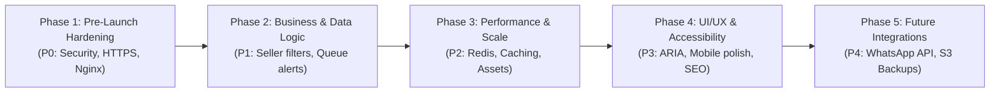

# Enterprise-Grade Website Audit & Production Readiness Review
## Deliverable 7: Production Remediation Roadmap & Deployment Guide

**Project:** Alishe Nails (`alishe-nails`)  
**Deployment Target:** Production Linux Server (Ubuntu 24.04 LTS / Nginx / PHP 8.2-FPM / MySQL 8.0 / Redis)  
**Execution Strategy:** Sequential, phased rollout preserving 100% existing functionality without breaking working code.

---

## 1. Phased Remediation Roadmap



---

### Phase 1: Pre-Launch Production Hardening (P0 - Immediate Blockers)
*Target: Complete before pointing public DNS to production server.*

| Step | Task | Target File | Action Required |
|:---:|---|---|---|
| **1.1** | Configure Production Secrets | `.env` | Set `APP_ENV=production`, `APP_DEBUG=false`, `APP_URL=https://alishenails.com`, generate strong `APP_KEY`. |
| **1.2** | Secure Session Cookies | `config/session.php` & `.env` | Enforce `SESSION_SECURE_COOKIE=true`, `SESSION_HTTP_ONLY=true`, `SESSION_SAME_SITE=lax`. |
| **1.3** | Nginx Upload Security | `/etc/nginx/sites-available/alishenails` | Add explicit rule denying PHP execution inside `storage/`, `images/`, and `videos/`. |
| **1.4** | Production Admin Credentials | `.env` | Generate unique cryptographically random password for `ADMIN_SEED_PASSWORD` prior to initial seed. |

#### Nginx Site Configuration Snippet:
```nginx
server {
    listen 443 ssl http2;
    server_name alishenails.com www.alishenails.com;
    root /var/www/alishe-nails/public;
    index index.php index.html;

    # SSL Certificates (Certbot Let's Encrypt)
    ssl_certificate /etc/letsencrypt/live/alishenails.com/fullchain.pem;
    ssl_certificate_key /etc/letsencrypt/live/alishenails.com/privkey.pem;

    # Security Headers
    add_header X-Frame-Options "SAMEORIGIN" always;
    add_header X-Content-Type-Options "nosniff" always;
    add_header Referrer-Policy "strict-origin-when-cross-origin" always;
    add_header Strict-Transport-Security "max-age=31536000; includeSubDomains" always;

    # P0 Security Rule: Block PHP execution in upload folders
    location ~* ^/(storage|images|videos)/.*\.php$ {
        deny all;
        return 404;
    }

    # Static Asset Caching
    location ~* \.(?:css|js|woff2?|svg|webp|png|jpg|ico)$ {
        expires 1y;
        add_header Cache-Control "public, max-age=31536000, immutable";
        access_log off;
    }

    location / {
        try_files $uri $uri/ /index.php?$query_string;
    }

    location ~ \.php$ {
        include snippets/fastcgi-php.conf;
        fastcgi_pass unix:/run/php/php8.2-fpm.sock;
        fastcgi_param SCRIPT_FILENAME $realpath_root$fastcgi_script_name;
        include fastcgi_params;
    }

    location ~ /\.(?!well-known).* {
        deny all;
    }
}
```

---

### Phase 2: High Priority Data & Business Logic Guardrails (P1)
*Target: Complete during initial staging test window.*

| Step | Task | Target File | Action Required |
|:---:|---|---|---|
| **2.1** | Product Show Route Seller Guard | `ProductController.php` | Ensure `ProductController::show` checks `scopeActive()` so expired seller products are not purchasable via direct URL. |
| **2.2** | Failed Queue Alerting | `SendOrderEmails.php` | Add `failed(\Throwable $exception)` callback logging critical alerts if SMTP fails after 3 tries. |
| **2.3** | Order Cancellation Stock Restoration | `AdminOrderController.php` | Verify idempotent stock restoration using `stock_restored_at` check. |
| **2.4** | Commission Ledger Precision | `AdminMarketplaceController.php` | Confirm payout queries aggregate frozen `order_items.seller_earning` amounts. |

---

### Phase 3: Performance & Scalability Optimization (P2)
*Target: Implement before running paid advertising or influencer drops.*

| Step | Task | Target File | Action Required |
|:---:|---|---|---|
| **3.1** | Redis Session & Cache Migration | `.env` | Switch `SESSION_DRIVER=redis` and `CACHE_STORE=redis` to eliminate database row locking under high concurrency. |
| **3.2** | Facet Cache Invalidation on Seller Events | `SellerSubscription.php` | Invalidate `shop_sidebar_facets` cache key when a seller subscription status changes. |
| **3.3** | Search Query Optimization | `ShopController.php` | Implement MySQL `FULLTEXT` indexing on `products` table for catalog scaling. |

---

### Phase 4: UI/UX, Accessibility & SEO Polish (P3)
*Target: Refinements during ongoing sprint.*

| Step | Task | Target File | Action Required |
|:---:|---|---|---|
| **4.1** | Screen Reader Accessibility | `navbar.blade.php`, `cart/index.blade.php` | Add `aria-label` attributes to mobile drawer toggle, wishlist icon, and modal close buttons. |
| **4.2** | Mobile Table Scroll Hint | `admin/orders/index.blade.php` | Add a visual horizontal scroll hint indicator for ultra-narrow mobile viewports (<375px). |
| **4.3** | Schema.org Structured Data | `products/show.blade.php` | Add JSON-LD schema markup (`Product`, `Offer`, `AggregateRating`) for Google rich search results. |
| **4.4** | Form Autocomplete Attributes | `checkout/index.blade.php` | Add `autocomplete="shipping given-name"`, `autocomplete="tel"`, and `autocomplete="email"` to speed up customer checkout. |

---

### Phase 5: Long-Term Enhancements & Third-Party Integrations (P4)
*Target: Post-launch operational maturity.*

| Step | Task | Description |
|:---:|---|---|
| **5.1** | WhatsApp Cloud API Webhook | Automate instant WhatsApp receipts to customer mobile numbers (`+92...`) when orders are placed. |
| **5.2** | Automated Off-Site Backups | Configure daily automated MySQL dumps and media directory sync to Cloudflare R2 or AWS S3. |
| **5.3** | Automated Instagram Token Refresh | Create a scheduled artisan command (`php artisan instagram:refresh-token`) to renew the Graph API access token before the 60-day expiry. |

---

## 2. Production Deployment Runbook (Step-by-Step)

Execute the following sequential terminal commands on the production Linux server:

### Step 1: Environment & Dependency Installation
```bash
# 1. Clone repository to web root
cd /var/www
git clone https://github.com/your-org/alishe-nails.git alishe-nails
cd /var/www/alishe-nails

# 2. Install production PHP dependencies (no dev packages, optimized autoloader)
composer install --no-dev --optimize-autoloader

# 3. Install Node packages and compile production assets
npm ci
npm run build

# 4. Configure environment file
cp .env.example .env
nano .env  # Configure database credentials, APP_URL, Redis, and SMTP
```

### Step 2: Database Migration & Storage Setup
```bash
# 5. Generate secure application encryption key
php artisan key:generate --ansi

# 6. Run database migrations with production confirmation flag
php artisan migrate --force

# 7. Create storage symlink for uploaded media
php artisan storage:link

# 8. Set correct file permissions for web server
chown -R www-data:www-data /var/www/alishe-nails/storage /var/www/alishe-nails/bootstrap/cache
chmod -R 775 /var/www/alishe-nails/storage /var/www/alishe-nails/bootstrap/cache
```

### Step 3: Production Caching & Optimization
```bash
# 9. Cache configuration, routes, and compiled views for maximum performance
php artisan config:cache
php artisan route:cache
php artisan view:cache
```

### Step 4: Background Supervisor & Scheduler Setup
Create `/etc/supervisor/conf.d/alishe-worker.conf`:
```ini
[program:alishe-worker]
process_name=%(program_name)s_%(process_num)02d
command=php /var/www/alishe-nails/artisan queue:work --sleep=3 --tries=3 --max-time=3600
autostart=true
autorestart=true
stopasgroup=true
killasgroup=true
user=www-data
numprocs=2
redirect_stderr=true
stdout_logfile=/var/www/alishe-nails/storage/logs/queue-worker.log
stopwaitsecs=3600
```
Update and start supervisor:
```bash
sudo supervisorctl reread
sudo supervisorctl update
sudo supervisorctl start alishe-worker:*
```

Add Laravel schedule to system crontab (`crontab -e -u www-data`):
```cron
* * * * * cd /var/www/alishe-nails && php artisan schedule:run >> /dev/null 2>&1
```

---

## 3. Disaster Recovery & Rollback Procedure

### Emergency Rollback:
If an issue is detected immediately after deploying an update:
```bash
# 1. Rollback code to previous git commit/tag
git checkout <previous-stable-tag>

# 2. Clear optimized caches
php artisan config:clear
php artisan route:clear
php artisan view:clear

# 3. Rollback latest migration if a database schema issue occurred
php artisan migrate:rollback --step=1 --force

# 4. Rebuild assets and re-cache
npm run build
php artisan config:cache
php artisan route:cache
php artisan view:cache

# 5. Restart queue workers to reload updated classes
php artisan queue:restart
```
